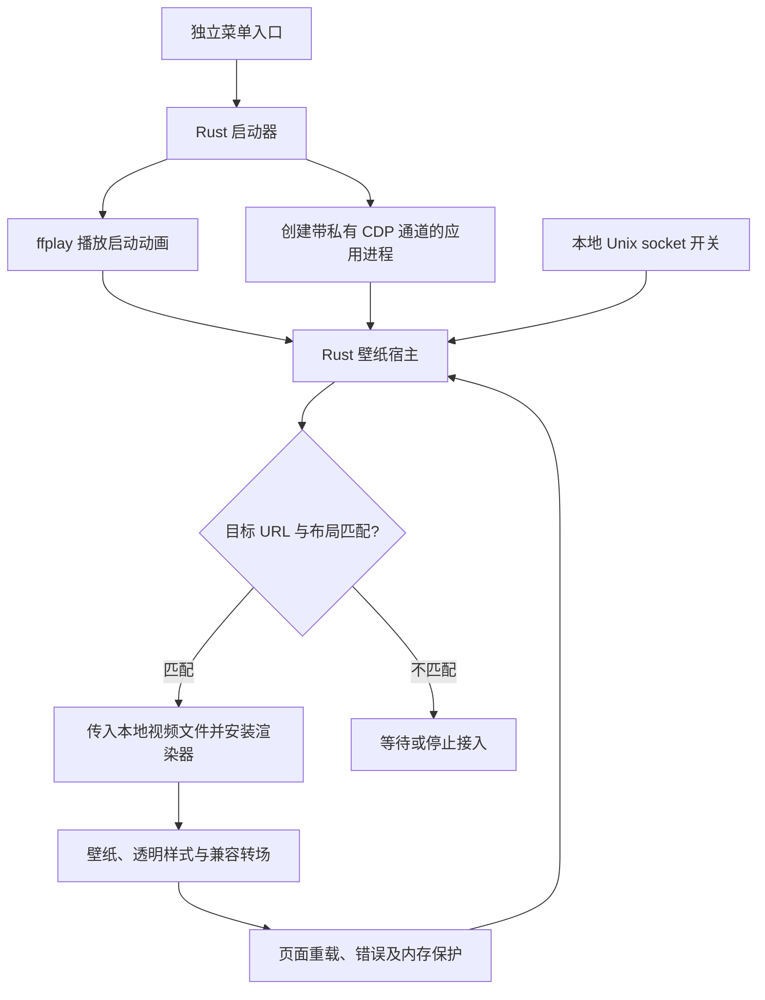

# Codex Dragon for Fedora

面向 **Fedora 44 / niri / Wayland** 的 Codex 启动动画与应用内动态壁纸适配。启动器和壁纸宿主使用 Rust，应用内渲染沿用上游 JavaScript/CSS。

当前版本：**v0.2.0 试用版**。本文对应 2026-10-24 的实现与验证记录。

> 已完成本机安装、私有通道验证及独立浏览器中的播放与恢复测试；真实登录账号界面的冷启动仍需使用者确认。Linux 泪滴／波纹为兼容效果，尚未逐帧复现 Windows 原版的窗口交接。

## 源项目与致谢

本项目基于以下公开实现开展 Fedora 适配：

- 原项目：[mytjxs/codex-startup-animation](https://github.com/mytjxs/codex-startup-animation)。
- 社区启动器与动态壁纸实现：[HanwenZhang-George/codex-startup-animation](https://github.com/HanwenZhang-George/codex-startup-animation)。
- 对应上游 PR：[增加可移植启动动画与完整动态壁纸](https://github.com/mytjxs/codex-startup-animation/pull/1)。
- 本次参考的社区源码提交：[165b187da2762f6fadac942b71905e44f39797c9](https://github.com/HanwenZhang-George/codex-startup-animation/tree/165b187da2762f6fadac942b71905e44f39797c9)。

感谢原项目作者及社区贡献者 HanwenZhang-George 提供动画、壁纸渲染逻辑和测试。`renderer.js` 与 `tests/Test-Renderer*.cjs` 保留上游实现；Rust 宿主、Fedora 安装工具和 `transition.css` 为本次 Linux 适配新增。

本项目不是 OpenAI 官方发行版。原代码、动画和依赖各自的权利归属不因本次适配改变；请参阅文末的授权说明。

## 目录

- [下载与发布文件](#下载与发布文件)
- [功能与当前范围](#功能与当前范围)
- [环境要求](#环境要求)
- [安装与首次启动](#安装与首次启动)
- [命令说明](#命令说明)
- [如何确认壁纸已生效](#如何确认壁纸已生效)
- [技术实现](#技术实现)
- [源码结构与编译](#源码结构与编译)
- [测试与验证边界](#测试与验证边界)
- [排查常见问题](#排查常见问题)
- [升级与卸载](#升级与卸载)
- [媒体与授权说明](#媒体与授权说明)

## 下载与发布文件

请从 [Releases](https://github.com/shuizhaodemumu/codex-dragon-fedora/releases) 获取发行附件。

| 文件 | 内容 | 用途 |
| --- | --- | --- |
| `codex-dragon-fedora-v0.2.tar.gz` | Linux 可执行程序、所需媒体、完整适配源码、说明与测试资料 | 希望直接使用的 Fedora 用户 |
| `codex-dragon-fedora-source-v0.2.0.tar.gz` | Rust 源码、上游渲染脚本、安装程序及测试，不含视频或已编译程序 | 阅读、审查或自行编译 |
| `SHA256SUMS` | 上述压缩包的 SHA-256 | 下载后核对完整性 |

完整运行包已经包含本适配所需媒体，无需另外下载 Windows 安装包。独立源码包不含视频，单独编译完成不代表已经具备可播放素材。

下载校验文件与压缩包后，在同一目录执行：

```sh
sha256sum --check SHA256SUMS --ignore-missing
```

GitHub 自动生成的 Source code 下载仅代表仓库内容；要获取可运行版本，请选择手动上传的完整运行包附件。

## 功能与当前范围

| 功能 | 当前实现 |
| --- | --- |
| 启动动画 | Rust 调用已有 ffplay 播放，支持 ESC / q 跳过 |
| 动态壁纸 | 首次常态，后续按 75% 常态 / 25% 粒子选择 |
| 出现间隔 | 两次出现之间保留 10–15 秒随机间隔 |
| 透明界面 | 通过匹配的应用布局设置背景与输入区样式，文字和控件保持可读 |
| 泪滴／波纹 | Linux 新增 CSS 兼容过渡，并非 Windows 原生交接的完整复制 |
| 本次壁纸开关 | 支持状态查询、关闭清理和重新启用 |
| 页面恢复 | 支持页面重载后重新接入 |
| 媒体错误 | 最多尝试两次恢复，继续失败后停用并尝试清理 |
| 内存保护 | 根据 Linux MemAvailable 暂停和恢复视频解码 |
| 独立入口 | 新增菜单项目，保留原 Codex 入口和默认协议处理器 |

尚未覆盖所有 Linux 客户端、桌面环境和未来页面结构。真实账号页的冷启动结果不能由模拟页面测试替代。

## 环境要求

已验证的本机环境如下：

| 项目 | 验证环境 |
| --- | --- |
| 操作系统 | Fedora 44 x86_64 |
| 合成器与会话 | niri / Wayland |
| 显示器 | 2560 × 1440，60 Hz |
| 启动动画播放器 | FFmpeg / ffplay 8.1.3，来自本机 ffmpeg-free 软件包 |
| 已安装的应用入口 | `/usr/bin/chatgpt` |
| 带私有通道的应用程序 | `/usr/lib/chatgpt/ChatGPT` |
| Rust 构建环境 | Rust 1.99.1，edition 2021 |
| 独立浏览器自测 | Google Chrome 156 |
| 已探测的客户端内核 | Chrome 155 |

这不是对所有 Fedora 44 安装方式的兼容保证。其他客户端路径或打包方式需要适配；当前实现没有自动发现所有 Linux 安装目录。

直接运行发行包不需要 Rust 工具链；从源码构建才需要 Rust 和 Cargo。安装脚本使用 Python 3，并依赖 `hashlib.file_digest`，需要 Python 3.11 或更新版本。

可以先检查本机入口与播放器：

```sh
command -v ffplay
python3 --version
test -x /usr/bin/chatgpt
test -x /usr/lib/chatgpt/ChatGPT
```

## 安装与首次启动

### 1. 解压并检查

```sh
tar -xzf codex-dragon-fedora-v0.2.tar.gz
cd codex-dragon-fedora
./codex-dragon --check
```

不要将不完整的媒体副本与旧程序混在一起。

### 2. 安装独立入口

```sh
python3 install.py
```

使用当前用户目录安装，不要求管理员权限。默认位置为：

```text
~/.local/bin/codex-dragon
~/.local/share/codex-dragon/
~/.local/share/applications/codex-dragon.desktop
```

设置了 `XDG_DATA_HOME` 时，素材与桌面入口使用相应目录，程序仍安装至 `~/.local/bin/`。若目标已存在，安装程序停止，避免覆盖已有文件。

### 3. 完整退出后重新打开

先保存工作，通过应用的退出功能正常完整退出 Codex，再从菜单 **“Codex 龙娘启动动画”** 打开，或运行：

```sh
~/.local/bin/codex-dragon
```

应用必须由新入口创建，才能持有私有壁纸通道。已经运行的实例无法事后补接：此时再次运行新入口会激活现有应用，而不是注入壁纸。

便携使用可在解压目录直接执行 `./codex-dragon`；保持可执行程序与 `assets/` 在同一层。

## 命令说明

| 参数 | 行为 |
| --- | --- |
| `--preview` | 只播放启动动画，不启动或退出 Codex |
| `--check` | 检查启动视频、播放器、应用入口及已有进程 |
| `--skip-animation` | 跳过启动动画；满足条件的冷启动仍可启用壁纸 |
| `--no-wallpaper` | 本次只使用启动动画与正常应用入口 |
| `--wallpaper-status` | 查询当前受管会话的壁纸状态 |
| `--wallpaper-off` | 关闭本次壁纸，尝试恢复背景和输入区样式 |
| `--wallpaper-on` | 在已有受管会话中重新启用壁纸 |
| `--wallpaper-self-test DIR` | 使用独立 Chrome 配置运行本地模拟工作区测试 |
| `--video PATH` | 指定启动视频；媒体目录以该视频所在目录确定 |
| `--app PATH` | 指定要启动的程序，主要用于开发或测试 |
| `--force-animation` | 即使已有应用进程，也尝试播放启动动画 |
| `-- URI ...` | 原样传递后续参数给应用 |

常用操作：

```sh
~/.local/bin/codex-dragon --preview
~/.local/bin/codex-dragon --wallpaper-status
~/.local/bin/codex-dragon --wallpaper-off
~/.local/bin/codex-dragon --wallpaper-on
```

`--app` 指向其他程序时默认不启用壁纸。另有 `--wallpaper` 开发参数用于显式开启；这不代表任意应用都兼容，仍受目标页面和布局约束。

## 如何确认壁纸已生效

运行：

```sh
~/.local/bin/codex-dragon --wallpaper-status
```

正常播放期间，应同时看到：

```json
{
  "enabled": true,
  "playing": true,
  "firstFrameConfirmed": true,
  "wallpaperApplied": true
}
```

状态含义：

| 状态 | 含义 |
| --- | --- |
| `waiting-for-workspace` | 正在等待唯一、可识别的应用工作区 |
| `preparing` | 已开始准备壁纸，尚不能据此断言实际播放 |
| `visible` | 渲染器处于显示阶段，还应结合首帧和播放字段判断 |
| `gap` | 两次视频出现之间的正常间隔 |
| `disabled` | 已关闭本次壁纸 |
| `cleanup-unconfirmed` | 已请求关闭，但清理结果未获确认 |
| `not-attached` | 接入或素材准备失败，应查看 reason |
| `recovering` | 正在尝试从媒体错误恢复 |
| `disabled-after-renderer-error` | 渲染错误持续或布局失效后已停用 |
| `channel-unavailable` | 私有通道请求失败 |

最小化、页面隐藏、内存保护或正常视频间隔时，`playing: false` 不必然表示故障。只有通道已连接、程序已启动或安装已成功，都不能单独证明壁纸已播放。

## 技术实现



### Rust 负责什么

- 启动互斥、进程管理、参数传递及 20 秒动画超时。
- 通过继承的 Unix 文件描述符建立私有 CDP 通道，不监听 TCP 调试端口。
- 校验受管目标的应用 URL，等待符合布局条件的工作区。
- 使用 CDP 将本地视频传入受管页面的文件输入。
- 维护渲染器租约、媒体恢复与本地 socket 控制。
- 处理 Linux 内存保护，以及独立浏览器自测。

### JavaScript / CSS 负责什么

- 应用内部的视频节点、透明样式和动态布局绑定。
- 保留原版常态／粒子选择、间隔、可见性与生命周期策略。
- 新增 Linux 泪滴、波纹过渡；退出或关闭时清理新增样式。

宿主不需要读取聊天内容，不启动本地文件服务器，也不修改 Codex 应用包。Codex 本身仍按其正常方式联网。

### 内存与恢复策略

Linux 版读取 `/proc/meminfo` 的 `MemAvailable`：

- 低于 512 MiB 时请求暂停视频解码。
- 恢复至至少 1 GiB、连续稳定 30 秒后请求恢复。
- 这与 Windows 的可用提交内存不是同一指标。

媒体错误最多进行两次恢复尝试；持续失败或渲染器退役后停用壁纸并尝试清理。恢复请求不等于恢复成功，仍需重新确认首帧与播放状态。

壁纸宿主在受管应用会话期间保持运行；关闭壁纸请使用 `--wallpaper-off`，它不要求结束应用。

## 源码结构与编译

独立源码包的主要结构：

```text
codex-dragon-fedora/
├── Cargo.toml
├── Cargo.lock
├── src/
│   ├── main.rs           # 命令、动画与启动流程
│   ├── cdp.rs            # 私有通道与 CDP 消息
│   ├── wallpaper.rs      # 接入、控制、恢复与清理
│   ├── pressure.rs       # Linux 内存恢复策略
│   └── selftest.rs       # 独立工作区功能验证
├── renderer.js           # 保留的上游渲染器
├── transition.css        # Linux 兼容转场
├── install.py            # 当前用户安装与卸载
├── test_launcher.py      # 使用假播放器/应用的流程测试
├── tests/                # 上游浏览器测试及本机测试报告
├── README.md
└── UPSTREAM-NOTICE.md
```

完整运行包还包含 `codex-dragon` 可执行程序与 `assets/` 媒体目录。

在完整源码目录中构建：

```sh
cargo build --locked --release
install -m 755 target/release/codex-dragon ./codex-dragon
```

Rust 依赖为 `libc`、`serde_json` 和 `base64`，具体版本见 Cargo.lock。运行时仍需要 ffplay、现有客户端及对应媒体文件；本项目不包含 Codex 客户端本体或账号。

## 测试与验证边界

截至 2026-10-24，已完成：

| 检查 | 结果 |
| --- | --- |
| Rust 单元测试 | 7 项通过 |
| 启动流程集成测试 | 8 项通过 |
| 上游渲染器布局检查 | 166 项通过 |
| 上游渲染器内存行为检查 | 22 项通过 |
| 渲染质量指标边界检查 | 8 项通过 |
| 独立工作区完整自测 | 原视频首帧、时间推进、粒子解码、透明样式与点击通过 |
| 宿主控制测试 | 关闭清理、重新启用、媒体错误恢复和页面重载后接入通过 |
| 素材核验 | 两个壁纸视频 SHA-256 与上游清单相符 |
| 本机安装 | 新入口与安装文件校验通过 |

浏览器测试中，截图和测试页面不包含真实对话。客户端还进行了私有通道响应与应用页发现验证，并只读确认了相关布局签名。

**尚未在此次工作中关闭真实登录会话并完成冷启动验收。** 以上结果不证明全部机器、显卡、桌面环境或未来客户端版本都兼容，也不构成持续帧率保证。

复现基础测试：

```sh
cargo test --locked
python3 test_launcher.py
./codex-dragon --wallpaper-self-test ./test-output
```

后两个命令需要先编译并将程序复制到项目根目录；完整自测还需要 Google Chrome 和两个壁纸视频。Node / Playwright 浏览器回归脚本的参数说明位于 `tests/Test-Renderer*.cjs` 文件头。

## 排查常见问题

### 动画结束了，但没有壁纸

先确认应用确实由新入口冷启动，再检查 `--wallpaper-status`。现有实例不能事后补上私有通道；只有动画正常播放也不等于应用内壁纸接入成功。

### 提示没有活动的壁纸宿主

当前应用可能从原入口启动，或仍是安装前的旧实例。保存工作、正常完整退出，再使用新入口打开。不要强制结束仍在处理任务的应用。

### 一直停在 waiting-for-workspace

可能尚未进入工作区、存在多个匹配的页面，或界面结构已变化。当前宿主要求唯一且符合约束的目标，不会对任意网页注入。

### 壁纸出错或透明度不合适

先执行 `--wallpaper-off`，检查 `cleanupConfirmed`。需要继续尝试时使用 `--wallpaper-on`；也可在下次启动使用 `--no-wallpaper`。

### 启动动画播放过慢

本机原 144fps H.264 素材未能在 20 秒内播完，兼容副本因此保留 2560×1440 与 8 秒内容，转为 60fps MPEG-4 Part 2。两个应用内壁纸视频未因此重新编码。

Wayland 会话默认优先使用 SDL 原生 Wayland 后端；显式设置的 `SDL_VIDEODRIVER` 优先。启动动画失败或超时后，仍会尝试打开应用。

## 升级与卸载

升级前先保存工作并正常退出受管应用。使用旧安装的卸载脚本，再从新包安装：

```sh
python3 ~/.local/share/codex-dragon/install.py --uninstall
```

随后在新包解压目录执行：

```sh
python3 install.py
```

仅卸载时执行第一条命令即可。卸载器依据安装清单清理本次安装的文件；被手工修改的文件会保留并报告。自定义 `XDG_DATA_HOME` 时，请使用实际安装位置里的卸载脚本。

## 媒体与授权说明

本适配所需媒体来源于上游完整发行包，原包 SHA-256 为：

```text
3b5f1201ddfb244a93ed2f8391e1c0f048c5956a76ed7a9f8d218e92bea48b07
```

- 原启动视频另存为 `assets/startup-original.mp4`。
- `assets/startup.mp4` 是本次生成的 Fedora 兼容播放副本，编码和帧率发生变化。
- `dragon-wallpaper-ambient-2k-144fps.mp4` 与 `dragon-wallpaper-particles-1440p48.mp4` 保持上游文件内容。
- 完整运行包只包含本适配需要的媒体，不等同于上游全部 46 项素材的镜像。

上游来源说明表示未找到原项目代码的明确许可证。本仓库保留来源信息，不擅自为上游代码、测试或视频另行授予 MIT、GPL 等授权。源码可见和文件可下载，不代表所有内容均已获得任意再许可或商业使用授权。

Rust 依赖保留各自许可证；第三方代码和媒体的后续使用需遵守其权利人的授权。发布本适配不代表原作者或 OpenAI 为其背书。
